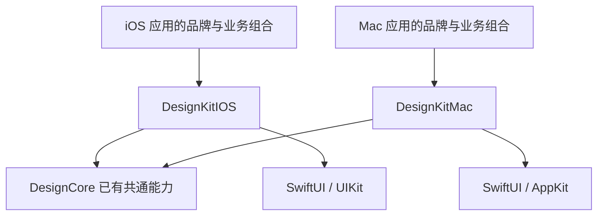

# iOS 与 macOS 组件体系设计

日期：2026-11-12。状态：第二版方案索引，Skill 审查的文档缺项已补齐；尚未完成双端抽取、迁移或发布。

完整交付范围与阶段以 `ios/Docs/UI_FOUNDATION_PLAN.md` 为准；全局设计与配置规则分别见 `ios/Docs/DESIGN_TOKENS.md`、`ios/Docs/DESIGN_CONFIGURATION.md`。目标已扩展为可供新项目采用的专业 UI 基础库，不仅是按钮封装。

首批组件实施契约见 `ios/Docs/COMPONENT_SPECIFICATIONS.md`，明确默认值引用、状态与事件；复审状态见 `ios/Docs/UI_FOUNDATION_SKILL_REVIEW.md`。当前 Mac 原型不代表已实现第二版全部规格。

## 已确认方向

- 两套独立设计规范与平台组件：iOS / iPadOS 18+；macOS 26+、Apple Silicon。
- 提炼 ADBox 已有组件，后续应用按产品消费 `DesignKitIOS` 或 `DesignKitMac`，不复制项目源码。
- 平台间共用原生语义和已成立的基础能力，不强制共用布局、尺寸、动效或控件实现。
- 两套规范分别见 `ios/Docs/IOS_DESIGN_SYSTEM.md`、`ios/Docs/MACOS_DESIGN_SYSTEM.md`。
- 原 Mac-only 抽取计划调整为双平台设计优先；已写入 Mac 原型保留，不能据此认定公开接口已稳定。

## 源码基线

| 范围 | 本轮确认事实 |
|---|---|
| ADBox 配置 | `ios/Package.swift` 为 iOS 18 / macOS 26；Mac 目标 arm64 |
| ADBox iOS 控件 | `ios/TVRemote/` 文本扫描约 224 处 Button、8 处 Menu、3 处 Picker、4 处 Toggle、22 处 TextField/SecureField 声明 |
| ADBox Mac 控件 | `ios/Mac/` 文本扫描约 152 处 Button、7 处 Menu、8 处 Picker、11 处 Toggle、30 处 TextField/SecureField 声明 |
| 统计限制 | 包含菜单项、组件内部、未发布入口与测试辅助代码；不是重复数量，不是需重写数量，不包含全部初始化语法 |
| ADBox 本地组件 | `ios/Sources/Foundation/DesignKit/` 混有品牌色、双端令牌和 iOS 交互能力；Mac 另有 `ios/Mac/Chrome/` |
| 基础库已有产品 | `DesignCore`、`DesignKitIOS`、`DesignKitMac` 已存在；原平台 UI 模块主要负责主题管理 |
| 当前工作区 | 两端首批组件、类型化主题与独立示例已写入；根清单、模板和 Apple CI 统一 iOS 18 / Mac 26 arm64；新 API 未发布 |

本文引用的 ADBox 路径均相对 ADBox 仓库根；基础库路径相对本仓库根。没有把 ADBox 源码放入本仓库依赖图。

## 模块与依赖

- iOS 应用只依赖平台 UI 产品 `DesignKitIOS`；Mac 应用只依赖 `DesignKitMac`。共享业务、认证、购买继续使用各自既有产品。
- `DesignKitIOS` 与 `DesignKitMac` 互不依赖，不允许 Mac 为取得主题类型而引入 iOS 产品。
- `DesignCore` 保留既有 `ThemeMode`、Motion、语言/主题选择等能力。本轮不为目录整齐批量拆迁既有 API，也不把两端按钮强塞进共享控件基类。
- 需要新增共享类型时，须有实际双端相同契约；原生 `ButtonRole`、`Binding`、泛型选项与 `Label` 已覆盖的能力不再包装一套。
- 不创建新的 AppShared、渲染引擎、控件注册中心或依赖注入框架。

### 优先修正的现有依赖

ADBox 的 `ios/Sources/Foundation/DesignKit/KitExports.swift` 当前无条件导出 `DesignKitIOS`；`ios/Package.swift` 的本地 DesignKit 以及 `ios/project.yml` 的 Mac 目标也引用它。后续迁移必须按平台条件依赖并分别导出对应 UI 产品。

两端 `ThemeManager` 是不同实现：iOS 同步 UIWindow 外观，Mac 同步 NSApplication/NSWindow 外观。切换依赖时保留用户设置键及默认主题，核对 Mac 根壳手动外观同步，不可只换 import；不要同时导入两个同名 ThemeManager 再依靠隐式名称解析。

## 公开接口原则

两端公开组件统一使用 E 前缀，例如 `EButton`、`EPicker`；平台由 DesignKitIOS / DesignKitMac 模块区分。组件仍独立实现，相近名称不要求参数或交互完全一致。这些接口已实现，仍须完成目标系统验收后才能发布稳定版本。

| 统一的调用概念 | 独立的平台决定 |
|---|---|
| 标题、图标/自定义 Label、动作闭包 | 字号、触点、内边距、圆角与按钮形状 |
| primary / secondary / plain；原生 destructive role | iOS 触摸反馈与 Mac 悬停、焦点、快捷键表现 |
| 外部 isBusy、disabled、选择 Binding | 原生玻璃/标准材质、toolbar 背景处理 |
| 表单标题、说明、错误文案 | 键盘避让、滚动、菜单/Popover/Sheet 的呈现 |
| 强类型选项和稳定 ID | iOS 单手操作与 Mac 密集多列布局 |

主题在每个应用根及独立窗口根注入；组件内部不查询 ADBox 品牌色、设备或账户单例。品牌资源通过 Label 提供，组件不下载图标。危险角色和错误语义不能被品牌强调色覆盖。

## 抽取范围与次序

1. **规范与接口**：确认两套控件状态、布局、主题、可访问性与版本策略，保留各端现有业务行为。
2. **平台基础件**：按钮、图标操作、动作菜单、选择器、开关、文本/密码/搜索输入、表单行。每端有独立展示和状态测试。
3. **通用组合**：iOS 页头、设置行、提示与进度承载；Mac 表单动作、工具栏操作组与建议下拉。先核对宿主/生命周期，再迁移。
4. **ADBox 接入**：先以现有组件名做薄适配，保留业务配置与门控；逐页迁移到已发布固定版本，验证后删掉旧实现。桥接不长期保留第二套材质逻辑。
5. **后续产品复用**：新项目导入对应平台产品并配置品牌主题；独立展示应用和模板提供接入样例。

第一轮不抽遥控器业务、完整付费墙、设备页、签名流程、账户状态或后台同步；不为抽取恢复本版隐藏入口。系统认证品牌按钮继续归现有 AuthUI/认证模块，不能随通用按钮主题随意重绘。

## 可用性与交付门槛

- 组件在不依赖 ADBox、只使用公开产品的示例中编译、启动和操作。
- iOS 最低 18 与当前最新支持大版本分别验收；相关玻璃场景保留 26 引入节点。Mac 必须覆盖 26，27 等后续版本只作补充。没有 iOS 19–25 的公共大版本回归矩阵。
- 覆盖明暗、长文案、大字号、disabled/busy/error/destructive、VoiceOver、减少透明度与减少动态效果。
- 选择器测试双向绑定、禁用选项、动态候选、Optional 选择；输入测试中文组合、粘贴、焦点、提交与安全输入。
- 提示覆盖初始非空、连续替换、消失取消、宿主销毁；自动消失不能影响重要错误处理或模态状态。
- 公开文档、展示应用、测试和版本说明一起发布。每个消费项目仍需更新锁定版本并做宿主回归，“改一个组件”不代表所有已安装应用自动改变。

## 当前验证边界

最新首批组件、独立应用和验证状态统一记录在 `ios/Docs/UI_FOUNDATION_IMPLEMENTATION.md`。旧 SwiftUI 建议 overlay 已由原生 NSComboBox 替换；不能沿用旧实现的键盘验收结论证明新实现。

本机 macOS 27.2.1 的测试与窗口核对不等于 macOS 26 验收。iOS 最低系统、玻璃节点与最新系统分别验证；未通过的交互和目标系统门槛继续保留。没有提交、推送、发布或迁移 ADBox。

## 官方依据

- [Apple iOS 18 发布](https://www.apple.com/newsroom/2024/09/ios-18-is-available-today-making-iphone-more-personal-and-capable-than-ever/)
- [Apple iOS 26 发布介绍](https://www.apple.com/newsroom/2025/06/apple-elevates-the-iphone-experience-with-ios-26/)
- [Designing for iOS](https://developer.apple.com/design/human-interface-guidelines/designing-for-ios)
- [Designing for macOS](https://developer.apple.com/design/human-interface-guidelines/designing-for-macos)
- [Adopting Liquid Glass](https://developer.apple.com/documentation/technologyoverviews/adopting-liquid-glass)
- [原生控件与样式](https://developer.apple.com/documentation/swiftui/controls-and-indicators)
