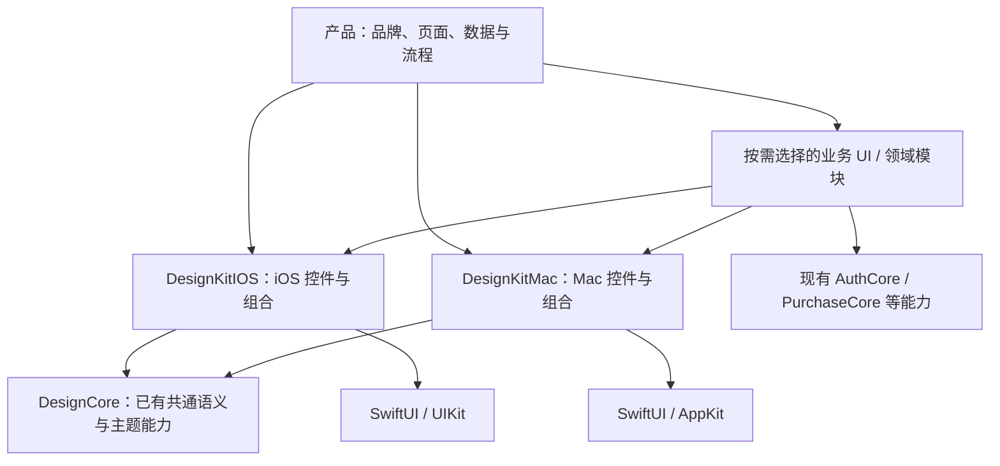

# Apple UI 基础库完整交付方案

更新：2026-11-12。版本：第二版方案；首批双端组件与独立示例已实现，目标系统验收、双端业务迁移与版本发布分别跟踪。

## 1. 交付目标

后续 iOS、macOS 项目直接采用本库的默认设计语言和交互规范，配置品牌并提供业务数据与动作即可开发页面；不再复制 ADBox 的组件或在每个页面重写颜色、材质、尺寸、反馈和控件状态。

这是一套包含规范、tokens、配置、组件、组合模式、示例、测试、模板与版本维护的产品化基础库，不以增加几个 Button wrapper 作为交付完成。

用户已明确：

- iOS / iPadOS 18+ 与 macOS 26+ 分别维护规范及平台组件，Mac 仅面向 Apple Silicon。
- 以 ADBox 两端已有实现和实际交互为来源，避免凭空设计庞大的控件体系。
- 后续其他项目采用相近的默认 UI 风格与交互，品牌和必要产品差异允许配置。
- ADBox 中有明确跨项目价值的业务能力也可抽取，但须与通用设计组件分层。

## 2. 规范与唯一来源

| 文档 | 负责内容 |
|---|---|
| `ios/Docs/UI_FOUNDATION_PLAN.md` | 交付范围、分层、业务抽取、阶段与验收标准 |
| `ios/Docs/DESIGN_TOKENS.md` | 三层 tokens、默认视觉语言、主题/状态解析及改动规则 |
| `ios/Docs/DESIGN_CONFIGURATION.md` | 全局配置、作用域、可覆盖项、业务边界与使用约束 |
| `ios/Docs/COMPONENT_SPECIFICATIONS.md` | 首批组件结构、默认变体、状态共存、事件/键盘与验收规格 |
| `ios/Docs/IOS_DESIGN_SYSTEM.md` | iOS 独立布局、交互、版本适配与组件来源 |
| `ios/Docs/MACOS_DESIGN_SYSTEM.md` | Mac 独立布局、交互、窗口、键鼠与组件来源 |
| `ios/Docs/DESIGN_SYSTEMS.md` | 当前源码事实、依赖问题及双端设计索引 |

文档与 Swift tokens、示例及测试一起维护。平台规范引用 token 名，不重复维护同一数字表；示例是规范的展示与验证对象，不能反过来把临时演示外观当作正式规范。

## 3. 默认视觉语言

- 沿用 ADBox 已有的中性背景、清晰正文、适量蓝强调与紧凑层次。默认主题应可直接用于新项目，不能要求使用者先自行设计整套 tokens。
- 默认品牌色采用 ADBox 当前蓝色体系，明确色值与系统映射见 token 规范；`Palette.gold` 是历史名称，实际已经表示蓝强调，不作为新库 token 名。设计值与真实界面的视觉验收分别记录。
- Mac 原型截图中的橙色是展示主题注入能力，不是已确认的默认品牌风格。
- 系统控件负责原生交互和自适应材质；默认样式中保留一致的主次、留白、字重、信息层级与状态反馈。
- 玻璃用于导航和必要操作层；内容区保持稳定可读。两端允许采用不同的尺寸、容器与呈现方式。
- 默认不用外部字体、图标或材质依赖。文字优先系统字体，功能图标优先 SF Symbols；资源通过原生 Label / 图片槽注入。

## 4. 能力分层

图中的业务 UI 是逻辑层级，不能因此创建一个同时依赖两端 UI 的统一 target。落地时分别作为平台产品，或在确有相同实现时使用条件依赖；基础控件层不反向依赖业务 UI。

### 基础层：tokens 与主题

两端各有一套默认值与类型化环境，统一颜色语义、排版角色、间距、尺寸、圆角、分隔、图标、动效与材质策略。共享概念和已存在的 DesignCore 能力，避免强行共享所有具体数值。

### 平台控件层

DesignKitIOS 与 DesignKitMac 各自提供基础控件，在平台内部集中维护样式和交互。同平台使用者不再逐页修材质；两端相同概念尽量采用相近参数含义。

### 通用组合层

组合基础控件形成经验证的页面局部结构，例如设置行、搜索过滤条、表单动作区、空态、任务进度、详情组。它们仍可位于对应 DesignKit 产品内，不为每种组合新增一个包。

### 可复用业务层

跨项目业务组件独立于基础设计产品，按实际依赖选择既有产品或新增窄范围模块。其通用数据与流程不能依赖 ADBox 的 AppModel、Store、路由、私有配置或环境单例。

### 产品层

品牌、功能目录、设备/账号状态、导航所有权、授权、持久化与具体动作由应用装配。公共组件不会通过全局 App 单例偷取上下文。

## 5. 第一轮组件目录

每一项都要有规范、公开 API、状态展示与必要测试；某端没有真实适用场景的控件标明原因，不为目录对称补造实现。

| 类别 | 交付内容 | 原生行为与边界 |
|---|---|---|
| 按钮 | 主次按钮、图标操作、文本动作、危险动作、busy 展示 | 保留 ButtonRole、disabled、键盘与可访问名称；busy 不自行启动异步任务 |
| 选择 | 动作 Menu、单选 Picker、分段选择、开关/适用的复选框 | 动作与选值分开；原生 Binding、tag、禁用项和 Optional 选择 |
| 输入 | 文本、密码、搜索、字段容器、说明/错误展示 | 不自动 trim、保存、截断或改写中文组合；提交与校验由产品负责 |
| 建议输入 | Mac 可输入下拉；iOS 有实际场景时使用本端合适的选择呈现 | 窗口边缘、滚动裁剪、输入法、键盘、选中语义必须通过再发布 |
| 反馈 | 轻提示、状态标签、内联错误、可取消/不可取消进度 | 重要错误不靠短暂 toast；不能伪造成功，取消能力以真实任务能力为准 |
| 内容结构 | 卡片/分组、标签值行、空态、错误态、加载占位、详情区 | 内容层不默认玻璃化；数据的 empty/loading/error 由外部明确提供 |
| 表单组合 | 表单行、设置行、字段组、动作区、可滚动表单 | 长文案/大字号不裁切；校验、保存与未保存确认归调用方 |
| 导航局部 | iOS 适用的页头/弹层头、Mac 工具栏操作组/详情检查区基础布局 | 保留返回/关闭差异；不拥有整个 App 的路由或快捷键注册表 |
| 呈现适配 | 基于原生能力的确认、输入、分享/文件选择承载协议 | iPad 锚点、Mac 焦点与窗口归属明确；不整体搬入 ADBox 根壳状态机 |

表格、树、大规模日志、可编辑网格等高复杂度控件单独列入后续能力批次；已有明确业务价值时安排，不因“专业库”要求一次性补齐所有桌面控件。

## 6. 每个组件必须写清的契约

1. 用途与不适用场景：解决哪种交互，何时使用系统原生控件或其他组件。
2. 结构与变体：标题、图标、说明、动作、尺寸档；公开变体必须对应真实用途。
3. 状态：normal、pressed、selected、focus、hover（适用时）、disabled、busy、invalid、destructive，以及可共存状态的结果。
4. 输入与输出：Binding 类型、选项身份、事件触发时机、是否提交、是否取消；不隐藏有副作用的行为。
5. 生命周期：焦点、弹层、窗口、取消、重复点击、宿主销毁；说明状态由谁持有。
6. 可访问性：名称、值、角色、键盘路径、VoiceOver 顺序、对比与字号；不只依赖颜色或 hover。
7. 布局：短/长标题、图标-only、窄窗/小屏、文字放大、滚动和动态候选。
8. tokens：引用哪些语义与组件 token，哪些几何由系统决定；不暴露一堆任意像素参数。
9. 版本：最低支持 iOS 18 + 当前最新支持大版本，相关玻璃场景保留 26 引入节点；Mac 26；具体差异、已知限制及迁移说明。
10. 证据：可运行示例、行为测试和目标系统界面验证。未验证明确列出，不能以截图数量代替。

不采用固定的 CSS 状态优先级机械覆盖原生控件。disabled 阻止触发，busy 保留名称并避免重复动作，focus 和 selected 可共存，危险语义优先于品牌色；具体渲染由各端原生控件及规范决定。

## 7. ADBox 业务能力抽取评估

下表为候选及落地条件，不表示已经实现或全部纳入当前发布。

| 实际来源（相对 ADBox 根） | 可复用部分 | 留在业务的部分 | 建议 |
|---|---|---|---|
| `ios/Sources/Foundation/DesignKit/BlockingProgressOverlay.swift`、`ios/Mac/Chrome/MacBusyOverlay.swift` | 任务阶段、进度、结果、取消动作的展示组合 | 安装/录制/抓包状态机、任务所有权与取消实现 | 优先抽通用任务展示，归平台组合层；状态和回调显式输入 |
| `ios/Mac/Features/Session/MacDeviceStatusButton.swift` | 状态摘要按钮、详情行与恢复动作的布局 | proxy/display 检测、设备归属、恢复命令与权限 | 先抽通用 StatusSummary 呈现；设备检测仍留 ADBox/专用领域模块 |
| `ios/Mac/Features/Home/MacDeviceCard.swift`、iOS 设备列表 | 带状态、地址、辅助动作的设备摘要展示 | DiscoveredDevice、扫描、连接、删除档案、身份核验 | 有设备类产品复用方向时抽平台 DeviceUI；不把设备模型放进 DesignCore |
| `ios/Mac/Features/Logs/MacLogTableView.swift` | 虚拟化日志展示、复制、多选、跟随尾部 | Logcat 数据源、AppModel 通知、过滤历史与设备流 | 高价值第二批候选；保留大数据和滚动锚点特性，区别于已有 LogKit 日志写入能力 |
| `ios/Mac/Features/Global/MacPaywallView.swift`、iOS PaywallView | 商品选项、权益对比、购买/恢复状态和法律入口的展示 | ADBox SKU、限额、价格推断、权益判断与购买后续动作 | 可做可选平台付费展示，复用 PurchaseCore；真实商品/验签结果由既有购买链路提供 |
| 两端设置/反馈页面 | 设置分组、关于行、反馈入口的 UI 组合 | 产品邮箱、隐私地址、诊断内容采集与用户发送 | 通用组合优先；产品配置显式注入，组件不自动上传或发信 |
| 文件页与签名工具 | 通用文件摘要/输出结果/操作进度展示 | security-scoped 访问、Keystore、ADB、Java 与外部工具执行 | 先复用基础组合；完整工具流程若抽取，应进入专用业务/平台模块 |
| 认证页面 | 现有认证 UI 的输入/状态展示复用 | Token、账户隔离、provider 生命周期和后台同步 | 先复用已有 AuthCore/AuthUI 与平台适配，不新造重复认证框架 |

设备卡片和日志表当前分别依赖 ADBox 的设备模型、缓冲类型及 AppModel；付费墙直接依赖 Store、限额目录和购买后续动作。它们不是改成 public 就能复用，必须先界定数据契约并保留原有业务保障。

### 业务组件准入

- 已有第二个实际消费者，或用户已明确确认这类跨项目产品需求；本轮总体复用目标允许评估，不代表每个 ADBox 模块都值得迁移。
- 能用稳定的状态/数据与动作边界描述，独立示例可以运行，不导入 ADBox。
- 处理购买、身份、权限、文件或任务生命周期的模块保留对应安全与错误语义；不以纯 UI 抽取名义删掉保障。
- 数据缺失保持 unknown，不以缓存或默认值伪装现场确认；取消、失败和待批准不能合并成成功。
- 新包或产品只有在依赖隔离/独立消费确有收益时创建，不为每个业务卡片建一个 target。

## 8. 新项目使用流程

1. 从对应平台模板生成工程，依赖已发布固定版本，默认启用标准设计主题。
2. 配置本产品的品牌、资源、本地化和允许的主题偏好；独立 window/scene 同样挂载主题与呈现环境。
3. 页面用公开组件和组合表达布局，只写数据、动作、选择绑定和必要的产品业务。
4. 需要设备/日志/付费等业务组件时，显式选择对应可选产品，并接入已有业务服务。
5. 常见页面的颜色、圆角、控件高度和玻璃效果不再手写；图表/画布/特殊遥控按键等经过评估的专用区域可保留定制。
6. 库升级后更新锁定版本并运行宿主回归；所有已安装应用不会因库源码变化自动改变。

不要求全局接管应用架构；已有业务 Store、路由与生命周期继续保留。默认主题要足够完整，新项目不配置外观也应能得到一致、可用的界面。

## 9. 分阶段交付

| 阶段 | 交付物 | 验收门槛 |
|---|---|---|
| A：规范与配置 | 两端规范、tokens、默认主题、配置边界、组件目录/状态契约 | 规范与源码现状区分；确认默认风格和可覆盖范围，不虚构已实现 API |
| B：基础控件 | 两端独立基础控件、展示应用、测试；iOS 清单/模板同步 18 | 原生行为、状态、绑定与主题可用；iOS 最低 18 与当前最新支持版、相关 26 节点，以及 Mac 26 各自验收 |
| C：页面组合 | 设置、表单、搜索、状态/任务、呈现组合 | 完整场景可用；不复制宿主的业务状态机，不产生大量一次性抽象 |
| D：ADBox 迁移 | 修正跨平台依赖、本地薄适配、逐页替换与必要回归 | 实际入口行为不变、数据与设置保留；确认后删被替代代码，隐藏功能仍隐藏 |
| E：跨项目验收 | 全新 iOS / Mac 消费工程或对应模板生成物 | 不引用 ADBox，只用公开产品即可构建并完成代表性页面操作；换品牌无需改组件内部 |
| F：稳定交付 | 公开文档、组件目录、版本/变更与迁移说明 | 所有必需检查通过、无已知阻断；发布后验证消费方实际解析到正确版本 |

设备 UI、日志查看器和付费展示根据准入结果形成各自小批次，可在基础稳定后并行规划；未确认的领域模块不自动成为本版发版承诺。

## 10. 验证标准

### 组件与主题

- token 类型、别名、默认值和可覆盖项有检查；平台独立 defaults 不互相泄漏。
- 原生选择绑定、菜单动作、输入组合、焦点/键盘、disabled/busy/error/destructive 等有行为证据。
- 颜色/字号/材质测试验证真实上下文，不把静态 RGB 或离屏透明图当作系统控件最终显示效果。
- 验证中文/英文长文案、Dynamic Type、产品字号、VoiceOver、增加对比度、减少透明度和减少动态效果。

### 宿主与领域

- iOS 18 + 当前最新支持大版本；玻璃组件保留 26 引入节点，与最新相同时去重；明确差异再增加具体版本。Mac 26 实机，更高 Mac 系统只作补充，不能替代最低支持系统。
- iOS 原型 393×852 pt，必验 375/393/430 pt；不把原型尺寸写死进布局，覆盖安全区、系统键盘及字号放大。
- popover/可能以 popover 呈现的 confirmationDialog 关联实际触发源与对象，按两端规范覆盖尺寸类别、滚动、移窗/缩窗及屏幕边缘。iOS 指定 arrowEdge 场景核对 18.0/18.1 差异，不把该差异扩成所有控件的全量矩阵。
- Mac App/扩展/自有 helper/测试与本地包部署设置一致，回读 LSMinimumSystemVersion、Mach-O minos 及发布包内实际 arm64 架构。产物、运行与真实交互/视觉分开记录。
- iPhone 小屏、iPad 选择呈现、Mac 窄窗/活动状态/独立窗口；检查菜单锚点、键盘避让、滚动裁剪和首次点击。
- 宿主释放、任务取消、重复点击、失败后恢复、多设备/账户隔离等按实际影响验证。
- 日志组件沿用现有 5 万行数据规模验证滚动、复制、锚点和更新，不把新数组复制成本带进逐行渲染；性能结论须有实测。
- 付费 UI 验证取消、失败、pending、恢复和已验签交付，不改变 PurchaseCore/应用权益语义来迁就 UI。

### 复用效果

- 新项目从模板到可运行代表页面完整走通，不只是 library 编译。
- 默认主题下无需逐页拼样式；替换品牌强调只改产品配置。
- 对同一基础组件的一次样式修改，在独立展示和 ADBox 已迁移入口同时生效。
- 记录迁移前后手写样式位置、保留定制及理由、代表页面的接入步骤；不以 Button 语句数量推断重复率，不承诺未经测量的效率百分比。

## 11. 版本与维护

- 沿用现有 SwiftPM 仓库和产品，不新增 UI 运行时依赖。
- 平台基线提高、公开接口/默认布局改变都需要标明兼容影响，并按仓库版本规则发布；保留旧标签供旧产品继续使用。
- 组件、默认 token 和文档同时更新；视觉变化需要变更说明，破坏性变化提供旧 API 到新 API 的对应关系。
- 接入模板在对应组件版本真正发布后引用该版本；不能提前把未发布 API 写进依赖旧版的业务工程。
- 公开样例用虚构数据，不携带真实设备、账号、诊断记录、密钥或产品服务凭据。

## 12. 当前与下一步

首批两端主题、按钮、选择、输入、表单、内容和反馈组件已实现。Mac 建议下拉改用原生 NSComboBox；独立示例分别只消费 DesignKitIOS / DesignKitMac。根包与模板统一 iOS 18、macOS 26，Mac CI 仅 arm64。ADBox 尚未接入新版本。

阶段 A 文档与 B/C 首批实现同步维护。具体接口与验证见 `ios/Docs/UI_FOUNDATION_IMPLEMENTATION.md`；尚未覆盖的导航/呈现组合不冒充已实现。目标系统行为、ADBox 迁移、发布版本与模板接入仍须各自验收。正式 Debug 替换遵守各项目备份、签名、唯一安装与目标系统验收规则。

## 13. 本轮 Skill 源模板调整

- 修改源位于 `dwy-cli/templates/ai-tools/skills/Apple/dwy-ios-development/` 与 `dwy-cli/templates/ai-tools/skills/Apple/dwy-macos-development/`：入口增加设计/复用场景路由，各增加 `references/design-system.md`。
- 仅存通用平台约束和设计规范完整性要求，不把本库蓝色、尺寸、业务组件或未发布 API 写进全局 Skill；原有系统下限与架构/验收规则保留。
- iOS appearance 参考将“18–25”旧样式措辞改为实际 iOS 18 支持，不生成不存在的大版本回归矩阵。
- 不修改 ADBox 的安装副本，不同步用户共享 Skills，不提交/推送/发布。结构、引用与临时目录中的发现/同步测试只是分发验证，不证明真实任务触发或组件视觉已验收。

官方依据：

- [Apple Color](https://developer.apple.com/design/human-interface-guidelines/color)
- [Apple Materials](https://developer.apple.com/design/human-interface-guidelines/materials)
- [Apple Accessibility](https://developer.apple.com/design/human-interface-guidelines/accessibility)
- [Designing for iOS](https://developer.apple.com/design/human-interface-guidelines/designing-for-ios)
- [Designing for macOS](https://developer.apple.com/design/human-interface-guidelines/designing-for-macos)
